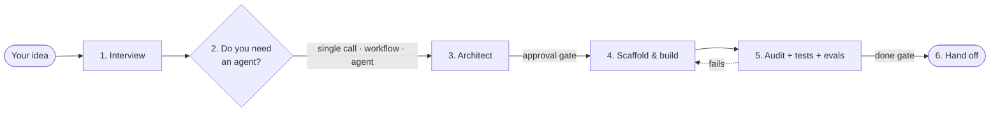

# agent-skills

[](https://github.com/Sritejam/agent-skills/actions/workflows/ci.yml)
[](LICENSE)

Agent Skills for building AI agents that hold up outside the demo. They work with Claude Code and other agents that support the [Agent Skills](https://code.claude.com/docs/en/skills) format.

| Skill | What it does |
|---|---|
| [**agent-architect**](skills/agent-architect/) | Interviews you, decides whether you need a single call, a workflow or an agent, gets the architecture approved, scaffolds a tested Claude/Python project, and won't call it done until a static audit and evals pass. |



## Install

With the [skills CLI](https://github.com/vercel-labs/skills) (Node 22.20+):

```bash
npx skills add Sritejam/agent-skills --skill agent-architect -a claude-code
```

Add `-g` to install for your user instead of the current project. Or copy it by hand:

```bash
git clone https://github.com/Sritejam/agent-skills
cp -r agent-skills/skills/agent-architect ~/.claude/skills/
```

Then describe what you want in Claude Code ("I want an agent that triages GitHub issues") or run `/agent-architect`. To review an existing agent repo: "review my agent in ./bot for problems".

## Quality

Every push runs [CI](.github/workflows/ci.yml):

- **Skill tests** (`pytest`, Python 3.10 through the latest release): the audit flags each known flaw with the right rule ID and nothing on clean code; the scaffold generates every pattern and rejects bad input; the package meets the Agent Skills spec.
- **Each of the 6 patterns, generated fresh:** installs, passes its own tests without an API key, has a valid eval set, and the audit fails until scaffold placeholders are replaced, then passes.
- **Install smoke test:** installs the skill with the `skills` CLI into an empty project and runs it from there.

Skill-level evals live in [`skills/agent-architect/evals/`](skills/agent-architect/evals/) in the `claude plugin eval` format.

## Credits

Inspired by:
- **Jacob Bushong**: *Claude Certified Developer Foundations (CCDV-F)* certification prep course (Udemy / [certmasterclass.com](https://certmasterclass.com/certification/claude-certified-developer-foundations)), covering all 8 domains: agents and workflows, applications and integration, and more.
- **neuraldev**: [*90% of Developers Don't Know These 20 AI Agent GitHub Repos*](https://medium.com/@neuraldev/90-of-developers-dont-know-these-20-ai-agent-github-repos-1b43b1882b80) (Medium).

Open-source projects referenced: see [credits.md](skills/agent-architect/references/credits.md). This is a personal/educational project.
