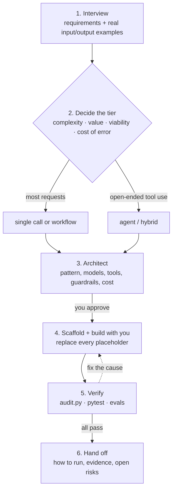

# agent-architect

An Agent Skill that takes you from "I want an agent that does X" to a running, tested Claude/Python project, with the usual LLM-app failures (unbounded loops, retry storms, prompt injection, leaked keys) designed out instead of discovered in production.

Its value is the **gates**: no code before you approve the design, and no "done" until the audit and evals pass.



**Modes:** *Build* (the full flow), *Audit* ("review my agent for problems": runs the static audit and walks you through fixes), *Advise* (design only, stops after the architecture).

## Support levels

The skill tells you which level a recommendation is at, and doesn't pass a recipe off as a tested template.

| Stack | Level | Templates |
|---|---|---|
| Claude Agent SDK | **Scaffolded** | `sdk_agent`, `orchestrator` |
| Anthropic SDK / Messages API | **Scaffolded** | `single_call`, `workflow`, `custom_loop` |
| MCP server (Python `mcp` SDK) | **Scaffolded** | `mcp_server` |
| LangGraph, PydanticAI, Strands | Recipe | guidance only, no template or tests |
| Non-Claude providers | Unsupported | none |

*Scaffolded* means `scaffold.py` generates it, CI generates and tests it on every push, and the audit understands it. Details: [`references/portability.md`](references/portability.md).

## What a generated project includes

| Concern | Where |
|---|---|
| One client: pinned model, transient-only retries (429/5xx/timeouts), request-id logging, token ledger | `agent/core/client.py` |
| Turn and budget caps | `agent/core/config.py` |
| PreToolUse guard: destructive commands, protected paths, secrets, approval for risky tools | `agent/core/guards.py`, `.claude/hooks/guard.py` |
| `stop_reason` handling, structured output, validate → re-prompt | `agent/core/output.py` |
| Untrusted-content delimiting, PII redaction | `agent/core/guards.py` |
| Frozen evals (representative, boundary, adversarial) + regression gate | `evals/` |
| Claude Code config, tests that run without an API key, `.env.example`, third-party notices | project root |

Optional integrations: `--with mem0,graphiti,langfuse,phoenix,mcp-github,mcp-playwright,mcp-filesystem`.

**Placeholders are enforced.** The example tool, schema and eval cases are marked `AGENT_ARCHITECT_PLACEHOLDER` / `placeholder: true`, and the audit fails (rule V4) until each is replaced. Evals passing against a fake tool prove nothing.

## Scripts

Run from the skill's directory, or prefix with its path:

```bash
python scripts/scaffold.py --name my-agent --dest ~/code --pattern sdk_agent --model claude-sonnet-5-5
python scripts/audit.py ~/code/my-agent          # exit 1 on errors; --json for machine output
```

The audit's rule IDs (L loops, E errors, O output, C context, S security, T tools, P permissions, M models, V verification) are explained in [`references/guardrails.md`](references/guardrails.md).

**Optional:** set `AGENT_ARCHITECT_REPOS` to a folder of local clones of the [referenced repos](references/integrations.md) (`owner_repo` names), and the skill checks library APIs against their source before writing code. Without it, it reads the installed packages instead.

## Testing

```bash
pip install pytest pyyaml
pytest                     # from the repo root: audit, scaffold and package tests, no API calls
```

Skill-level evals ([`evals/`](evals/)) check the skill's behaviour on realistic requests: pushing back when an agent isn't needed, holding the approval gate, auditing a flawed repo, and being honest about unsupported stacks. They use the `claude plugin eval` case format (Claude Code 2.1.269+):

```bash
claude plugin eval skills/agent-architect --allow-tools Write,Edit,Bash --scaffold
```

These are real, billed model runs.

## Layout

```
SKILL.md          instructions the agent follows (stages, gates, principles)
references/       loaded on demand: interview, decision, guardrails, integrations, portability, evals, credits
scripts/          scaffold.py, audit.py
assets/scaffold/  base project, 6 patterns, integration adapters
evals/            skill-level eval cases
tests/            tests for the scripts and the package
```
